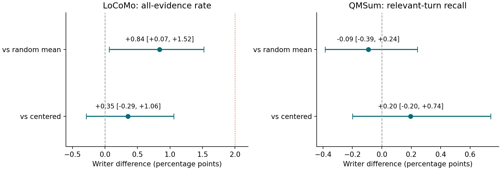
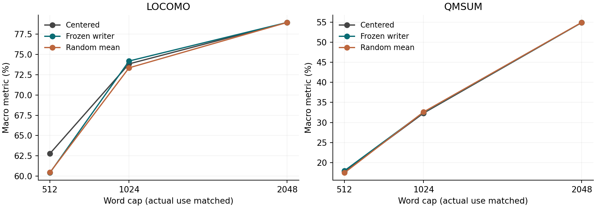

# گزارش پژوهشی مرحله‌ی ۱۷: مرز رویداد با فرصت و هزینه‌ی بازیابی ثابت

پژوهشگر: یوسف ابوالفتحی روزبهانی؛ کارشناسی مهندسی کامپیوتر، دانشگاه آزاد اسلامی واحد کرج. تاریخ: ۲۱ اکتبر ۲۰۲۶. مبنا: f1b7570. شاخه‌ی محلی: research/phase17-fixed-anchor-evidence. نتیجه‌ی این چرخه برای بازبینی آماده است؛ انتشار عمومی هنوز انجام نشده است.

## چکیده

پرسش پژوهش این است که آیا راهنمای مرزهای حافظه، با ثابت بودن فرصت‌های انتخاب متن، به بازیابی خود نوبت شاهد کمک می‌کند. ۳۷ منبع اولیه و مراحل ۱ تا ۱۶ ممیزی شدند. به دلیل وجود پیشینه‌ی مستقیم برای حافظه‌ی رویدادی، سهم منتخب یک پروتکل کنترل‌شده است. شاخص BM25 نوبتی، هشت لنگر، مجموعه‌ی پنجره‌های مجاز، طول هر پنجره و هزینه‌ی واقعی برای روش مرکزی، نویسنده‌ی ثابت و ۲۰ کنترل تصادفی یکسان نگه داشته شد. ۵۹۹ پرسش LoCoMo و ۲۴۴ پرسش QMSum در سه بودجه، ۵۵۶۳۸ ردیف خروجی تولید کردند. در ۱۰۲۴ واژه، اختلاف میانگین گفت‌وگویی نویسنده با میانگین تصادفی در LoCoMo برابر ۰٫۸۴ واحد درصد بود؛ بازه‌ی بوت‌استرپ خوشه‌ای توصیفی ۰٫۰۷ تا ۱٫۵۲ بود. این مقدار به آستانه‌ی کاربردیِ از پیش ثبت‌شده‌ی دو واحد درصد نرسید. اختلاف با مرکزی ۰٫۳۵ واحد درصد و بازه‌ی آن شامل صفر بود. در QMSum اختلاف با تصادفی منفی ۰٫۰۹ واحد درصد بود. نتیجه، برتری پایدار مرزبند را پشتیبانی نمی‌کند؛ ارزش اصلی در کنترل مخدوش‌کننده‌ها، محدود کردن ادعا و بازتولیدپذیری است. داده‌ها قبلا دیده شده‌اند؛ این مطالعه تاییدی مستقل نیست.

کلیدواژه‌ها: حافظه‌ی عامل؛ مرزبندی رویداد؛ بازیابی شاهد؛ فرصت انتخاب؛ هزینه‌ی برابر؛ ارزیابی بازتولیدپذیر.

## ۱. اهمیت، ضرورت و کاربرد

اگر دو روش مقدار متن یا فرصت انتخاب متفاوت داشته باشند، اختلاف عملکرد ممکن است از همین تفاوت بیاید. ثابت بودن فرمول BM25 با ثابت بودن نمایه و رتبه‌ی آن یکسان نیست. در مرحله‌ی ۱۶، نویسنده به جلسه‌ی شاهد بیشتری رسید، اما تعداد قطعات انتخابی برابر نبود و شاهد داخل جلسه معلوم نبود. اصلاح این نقص برای نتیجه‌گیری علمی و انتخاب حافظه‌ی کم‌هزینه ضروری است.

کاربرد مستقیم، ارزیاب قابل ممیزی برای مقایسه‌ی حافظه‌های متنی است: پژوهشگر می‌تواند ببیند آیا هزینه و فرصت واقعا برابرند، شاهد کامل آمده است یا فقط جلسه‌ی آن، و نتیجه در بازاجرای مستقل تکرار می‌شود یا نه. کاربرد احتمالی در طراحی دستیار مکالمه است؛ این مرحله خودِ دستیار پاسخ‌گو را ارزیابی نکرده است.

## ۲. پیشینه و ادعای تازگی

SeCom [R09]، ES-Mem [R10]، HingeMem [R11]، CompassMem [R05] و SEEM [R06] پیشینه‌ی مستقیم قطعه‌بندی موضوع/رویداد و حافظه‌ی ساخت‌یافته‌اند. ReFind [R16] گسترش متن پیرامون نوبت خام را بررسی کرده است. Fidelity Before Structure [R15] اهمیت متن بدون اتلاف و کنترل متغیرها را نشان می‌دهد. MemTrace [R36] انتساب خطای حافظه را در سطح عملیات بررسی می‌کند؛ آن کار تشخیص پسینی با پاسخ مرجع است، در حالی که انتخاب متن ما برچسب یا پاسخ مرجع نمی‌بیند.

بنابراین نوآوری الگوریتمی قطعی ادعا نمی‌شود. سهم بالقوه، قرارداد جفت‌شده‌ی خاص برای ثابت نگه داشتن هم‌زمان شاخص، لنگر، مجموعه‌ی نامزد و اندازه‌ی خروجی است. نبود نمونه‌ی کاملا یکسان در مرور محدود ما، اثبات تقدم جهانی نیست. اطلس، جدول هشت منبع پایه، شش خوشه‌ی ادبیات و ده جهت پژوهشی در پیوست‌های کدبنیان ارائه شده‌اند.

در علوم شناختی، مرزها به هدف، مکان، زمینه، پیش‌بینی و عدم قطعیت وابسته‌اند [R26–R29،R33]. نویسنده‌ی ما نویی واژگانی را می‌سنجد؛ آن را هم‌ارز ادراک اپیزودیک یا معنا در بحث سرل نمی‌دانیم. مطالعه‌ی ماشینی حاضر هیچ نتیجه‌ای درباره‌ی فهم ذاتی مدل به دست نمی‌دهد.

## ۳. طرح و قرارداد آزمایش

پروتکل و پیکربندی در commit محلی 2932298، پیش از محاسبه‌ی خروجی مرحله‌ی ۱۷ ثبت شدند. کد و کنترل‌های اولیه در efde7cf ثبت شد. این سابقه ثبت عمومی زمان‌دار نیست. امتیازهای انتخاب ایده پس از اولین اجرا به‌صورت مستند تنظیم شده‌اند و شاهد انتخاب پیشینی محسوب نمی‌شوند.

متغیر مستقل، قانون انتخاب پنجره از مجموعه‌ی مشترک است. BM25 با k1=1.2 و b=0.75 روی متن اصلی تمام نقش‌ها ساخته می‌شود. هشت نوبت نخست، لنگرها را تعیین می‌کنند. در هر جلسه، میان لنگرها ناحیه‌های غیرهم‌پوشان ساخته می‌شود و بودجه نوبتی میان آن‌ها تقسیم می‌شود. همه‌ی پنجره‌های پیوسته با عرض تعیین‌شده و شامل لنگر نامزدند. پنجره‌ی مرکزی فاصله‌ی مرکز را کمینه می‌کند؛ نویسنده و تصادفی، هم‌پوشانی با اپیزود حامل لنگر را بیشینه و سپس همان قاعده‌ی مرکزی را اعمال می‌کنند.

نویسنده‌ی مرحله‌ی ۸ ثابت است: حداقل ۶۴، سقف ۱۶۰ واژه، آستانه‌ی ۰٫۸۵ و تاریخچه‌ی سه نوبت. کنترل‌های تصادفی، شمار قطعات ساخته‌شده‌ی هر جلسه را برابر نگه می‌دارند و از فضای پارتیشن معتبر به‌صورت یکنواخت نمونه می‌گیرند. طول تک‌اپیزود داخلی برابر نیست؛ طول پنجره‌ی خروجی در تک‌پرسش دقیقا برابر است. کنترل‌ها گذشته‌نگرند؛ نویسنده قطعه‌های بسته را با آینده تغییر نمی‌دهد؛ پرسش بعد از تاریخچه مطرح می‌شود.

## ۴. داده، سنجه و عدم قطعیت

| داده | واحد/حجم | شاهد | سنجه‌ی اصلی در این مرحله |
|---|---|---|---|
| LoCoMo | ۷ گفت‌وگو، ۵۹۹ پرسش ثابت | شناسه‌ی نوبت شاهد | همه‌ی واژه‌های تمام نوبت‌های شاهد؛ میانگین مساوی گفت‌وگو |
| QMSum | ۳۵ جلسه، ۲۴۴ پرسش اختصاصی | اجتماع بازه‌های مرتبطِ شامل دو انتها | کسر نوبت‌های مرتبطِ کامل؛ میانگین مساوی جلسه |

بودجه، شمار واژه‌ی حاصل از عبارت منظم است، نه توکن مدل. نوبت نیمه‌بازیابی‌شده کامل محسوب نمی‌شود. برچسب موضوع، پاسخ، timestamp، memory flag و نقش افزوده وارد شاخص یا انتخاب نمی‌شوند. پنج پرسش QMSum دارای ۹ مورد نوبت خالی در اجتماع شاهدند؛ طبق طرح، فقط نوبت‌های خالی از مخرج خارج شده‌اند و پرسش‌ها باقی‌اند. همه‌ی ۵۹۹ پرسش LoCoMo شاهد غیرخالی دارند.

برآورد اصلی، اختلاف نویسنده با میانگین ۲۰ تصادفی در ۱۰۲۴ واژه است. ابتدا میانگین بذرها در هر پرسش و سپس میانگین پرسش در هر گفت‌وگو محاسبه می‌شود. بوت‌استرپ جفت‌شده با ۲۰۰۰ تکرار و بذر ۱۷، هفت گفت‌وگو را بازنمونه‌گیری می‌کند. QMSum ده خانواده‌ی منبع را بازنمونه‌گیری می‌کند و تمام جلسه‌های خانواده را حفظ می‌کند. این واحدها استقلال همه‌ی افراد یا موضوعات را تضمین نمی‌کنند. بذر و پرسش نمونه‌ی مستقل تلقی نشده‌اند؛ مقدار p تاییدی گزارش نمی‌شود.

## ۵. نتایج اصلی

| داده و سنجه | مرکزی | نویسنده | میانگین ۲۰ تصادفی |
|---|---:|---:|---:|
| LoCoMo؛ تعداد پوشش کامل | ۴۴۲ از ۵۹۹ | ۴۴۳ از ۵۹۹ | ۴۳۸٫۴۵ از ۵۹۹ |
| LoCoMo؛ میانگین مساوی گفت‌وگو | ۷۳٫۸۴٪ | ۷۴٫۱۹٪ | ۷۳٫۳۶٪ |
| QMSum؛ میانگین یادآوری نوبت مرتبط | ۳۲٫۳۳٪ | ۳۲٫۵۳٪ | ۳۲٫۶۲٪ |

عدد کسری تصادفی میانگین شمار موفقیت ۲۰ اجراست، نه شمار یک اجرای منفرد. درصدهای LoCoMo میانگین مساوی گفت‌وگو هستند و لزوما برابر تقسیم شمار کل بر ۵۹۹ نیستند. ۵۵۶۳۸ ردیف، تکرار شرایط روی ۸۴۳ پرسش است و حجم نمونه‌ی مستقل محسوب نمی‌شود.

| مقایسه در ۱۰۲۴ واژه | اختلاف، واحد درصد | بازه‌ی توصیفی ۹۵٪ |
|---|---:|---|
| LoCoMo؛ نویسنده منهای تصادفی | ۰٫۸۴+ | ۰٫۰۷+ تا ۱٫۵۲+ |
| LoCoMo؛ نویسنده منهای مرکزی | ۰٫۳۵+ | ۰٫۲۹− تا ۱٫۰۶+ |
| QMSum؛ نویسنده منهای تصادفی | ۰٫۰۹− | ۰٫۳۹− تا ۰٫۲۴+ |
| QMSum؛ نویسنده منهای مرکزی | ۰٫۲۰+ | ۰٫۲۰− تا ۰٫۷۴+ |

آستانه‌ی کاربردی، اثر حداقل دو واحد درصد همراه با بازه‌ی بالای صفر و نبود افت نقطه‌ای در برابر مرکزی بود. شرط اندازه‌ی اثر برقرار نشد. بازه‌ی بالای صفر برای مقایسه‌ی نخست مجوز ادعای برتری کاربردی یا تعمیم مستقل نیست.

## ۶. حساسیت و تحلیل شکست

| بودجه | LoCoMo مرکزی/نویسنده؛ شمار کامل | QMSum مرکزی/نویسنده؛ میانگین یادآوری |
|---|---|---|
| ۵۱۲ | ۳۷۳ / ۳۵۹ | ۱۷٫۷۷٪ / ۱۸٫۰۰٪ |
| ۱۰۲۴ | ۴۴۲ / ۴۴۳ | ۳۲٫۳۳٪ / ۳۲٫۵۳٪ |
| ۲۰۴۸ | ۴۷۲ / ۴۷۲ | ۵۴٫۸۷٪ / ۵۴٫۸۸٪ |

در سقف ۵۱۲، نویسنده ۱۴ موفقیت کمتر از مرکزی دارد. در ۲۰۴۸، شمار کامل LoCoMo در همه‌ی روش‌ها ۴۷۲ است؛ این تساوی به معنی یکسان بودن متن تمام پنجره‌ها نیست. در سقف ۱۰۲۴ همه‌ی روش‌ها دقیقا ۱۰۲۴ واژه مصرف می‌کنند. در ۲۰۴۸، ظرفیت ناحیه‌های مشترک برای ۲۴ پرسش LoCoMo و شش پرسش QMSum کمتر از سقف است؛ مصرف واقعی همچنان در تمام روش‌ها دقیقا یکسان است.

در LoCoMo اصلی، ۴۴۱ پرسش در هر دو روش مرکزی/نویسنده موفق، ۱۵۵ در هر دو ناموفق، دو فقط با نویسنده و یک فقط با مرکزی موفق‌اند. پنجره‌ها در ۴۸۹ پرسش تغییر کرده‌اند؛ تغییر متن لزوما نتیجه‌ی معیار را تغییر نمی‌دهد. همه‌ی جلسه‌های شاهد فقط در ۴۹۳ پرسش در مجموعه‌ی جلسه‌های قابل دسترس‌اند؛ بنابراین ۱۰۶ پرسش با تغییر پنجره‌ی درون همین جلسه‌ها قابل نجات نیستند. از ۴۹۳ پرسش باقی‌مانده نیز نویسنده در ۵۰ مورد همه‌ی نوبت‌ها را کامل نیاورده است. این تشخیص پسینی محدودیت لنگر و تخصیص را از هم جدا می‌کند، اما ثابت نمی‌کند کدام مرز انسانی باید انتخاب می‌شد.

در زیرگروه چندنوبتی، نویسنده ۲۹ از ۹۰ و مرکزی ۲۸ از ۹۰ موفق‌اند؛ در چندجلسه‌ای، ۱۱ از ۶۵ در برابر ۱۰ از ۶۵. این زیرگروه‌ها توصیفی‌اند و برای ساخت ادعای تازه انتخاب نشده‌اند. خروجی همه‌ی زیرگروه‌ها و بذرها محفوظ است.

## ۷. بازتحلیل تاریخی مرحله‌ی ۱۶

بازنمونه‌گیری پسینی در سطح ۱۰ شخصیت، با حفظ سه دوره‌ی هر شخصیت، اختلاف نقطه‌ای قبلی را عوض نمی‌کند. در آزمایش اصلی تاریخی، اختلاف ۳٫۰۷ واحد درصد و بازه‌ی توصیفی جدید ۱٫۲۹ تا ۴٫۹۲ است. در حساسیت تاریخیِ تعداد انتخاب برابر، اختلاف ۱٫۵۶ واحد درصد و بازه‌ی منفی ۰٫۱۵ تا مثبت ۳٫۲۴ است. بازه‌ی دوم شامل صفر می‌شود. این تحلیل روی خروجی‌های قبلی اجرا شده، نتایج تاریخی را بازنویسی نکرده و آزمایش جدید Memora نیست. تفاوت این اعداد با مرحله‌ی ۱۷ را نمی‌توان صرفا به حذف مخدوش‌کننده نسبت داد؛ داده، واحد شاهد و سیاست انتخاب نیز متفاوت‌اند.

## ۸. هزینه، کنترل کیفیت و بازتولید

هسته‌ی اجرا Python استاندارد، CPU و بدون API است. اجرای اصلاح‌شده ۲۲٫۷۰ ثانیه و بازاجرا ۲۲٫۵۲ ثانیه زمان دیواری داشت؛ اوج حافظه‌ی فرایند نخست حدود ۳۷۵٫۶۲ MiB بود. این زمان شامل بارگذاری/کنترل محلی و امتیازدهی است، نه دانلود، جست‌وجوی ادبیات یا ساخت گزارش؛ معیار کارایی روی همه‌ی رایانه‌ها نیست. هزینه‌ی API صفر است، نه هزینه‌ی کل پژوهش.

در هفت گفت‌وگوی LoCoMo، ۴۲۱۴ نوبت غیرخالی، ۹۶۸۰۶ واژه و ۱۲۰۹ قطعه‌ی نویسنده ساخته شد؛ در QMSum، ۲۰۷۰۱ نوبت غیرخالی، ۳۰۲۶۳۹ واژه و ۳۳۲۸ قطعه. هر کنترل تصادفی همان شمار پارتیشن نوبتی در هر جلسه را دارد. در هشت جفت تاریخچه–بذر LoCoMo و سه جفت QMSum، یک پارتیشن بدون واژه‌ی قابل شمارش است؛ شمار بازه‌های غیرخالی یک واحد کمتر می‌شود. تساوی شمار پارتیشن با تساوی بازه‌ی غیرخالی یکی نیست؛ پنجره، هزینه و فرصت خروجی همچنان دقیقا برابرند. خروجی در هر پرسش هشت پنجره است؛ تعداد جلسه‌ی خروجی در LoCoMo میانگین ۶٫۳۱ و در QMSum یک است. هشت پنجره لزوما هشت اپیزود نیستند.

اعتبارسنج ۲۵۲۹ گروه پرسش–بودجه را برای تساوی دقیق هزینه، عرض پنجره، تعداد انتخاب، تعداد جلسه و fingerprint فرصت بررسی کرد. بازاجرا فایل فشرده‌ی ردیف‌ها را بایت‌به‌بایت تکرار کرد. ۵۲ آزمون جمع‌آوری شد: ۵۱ موفق و یک آزمون تاریخی مرحله‌ی ۱۴ به علت نبود داده‌ی رسمی Memora در مسیر آزمون اجرا نشد؛ همه‌ی آزمون‌های مرحله‌ی ۱۷ اجرا شدند.

در ممیزی پس از نخستین اجرا، یک خطای سنجه‌ی فرعی جلسه‌ای و دو فرض نادرست اعتبارسنج درباره‌ی پر شدن سقف و نوبت خالی QMSum اصلاح شد. مقابله‌ی همه‌ی ردیف‌ها نشان داد فقط all_gold_sessions در ۶۹۹۶ ردیف تغییر کرده و انتخاب متن، هزینه و معیارهای نوبتی ثابت مانده‌اند. شرح و سند عددی اصلاح در پیوست موجود است؛ نتیجه‌ی قابل ارائه از اجرای اصلاح‌شده است.

## ۹. محدودیت، تصمیم و مسیر ادامه

اثر سنجیده‌شده به یک نویسنده‌ی واژگانی، هشت لنگر و این قانون انتخاب وابسته است. طول اپیزودهای داخلی برابر نشده است. برچسب LoCoMo ممکن است ناقص باشد و QMSum شاهد کمینه‌ی پاسخ نیست. هفت گفت‌وگو توان تعمیم محدودی دارند. داده‌ها بارها استفاده شده‌اند و تصحیح چندمقایسه‌ای برای نتیجه‌ی تاییدی مطرح نشده است. پاسخ مولد، استفاده‌ی صحیح از شاهد، فراموشی معتبر و ادراک انسانی سنجیده نشده‌اند.

قوی‌ترین سهم قابل دفاع اکنون «پروتکل انتساب و ممیزی اثر مرز» است. این چرخه دلیلی برای پیچیده‌تر کردن فوری حافظه با گراف یا مدل پرهزینه به دست نداد. برای تحویل کارشناسی، تثبیت ارزیاب، فصل روش/نتایج، راهنمای اجرا و دفاع از نتیجه‌ی منفی کافی و کم‌ریسک‌تر است؛ پذیرش دانشگاهی با استاد است. مسیر پژوهشی بعدی می‌تواند ثبت عمومی پروتکل، داده‌ی تازه با شاهد ریزدانه، و یک بازیاب دوم محلی باشد. انتخاب داده و بودجه باید پیش از دیدن نتیجه ثبت شود. افزایش بذرهای همین داده جای استقلال را نمی‌گیرد.

گزارش حاضر فصل پیشرفت پژوهش و بسته‌ی مرحله‌ی ۱۷ است؛ پایان‌نامه‌ی نهایی دانشگاه پس از تطبیق قالب و الزامات استاد تهیه می‌شود. انتشار عمومی این بسته مطابق دستور پژوهشگر تا تایید نهایی متوقف است.

## ۱۰. سپاسگزاری

از استاد امیر نوری ولنده، راهنمای دانشگاهی پروژه، برای هدایت علمی و پشتیبانی از ایده‌های نو سپاسگزارم. از دکتر آرش فکری، استاد من در علوم اعصاب شناختی و بنیان‌گذار FARDIAT، مجتمع فوق تخصصی مغز و شناخت، برای آموزش‌ها و بررسی و تایید پروپوزال سپاسگزارم. این آموزش‌ها خاستگاه شناختی پرسش پژوهش را شکل داده‌اند.

## پیوند اجزای بسته

- ممیزی مراحل ۱ تا ۱۶: phase17_state_ledger.md
- اطلس ۳۷ منبع: phase17_literature_atlas.md و .json
- تحلیل شکاف و هشت منبع پایه: phase17_frontier_synthesis.md
- ده ایده، امتیازدهی و نقد: phase17_candidates.md
- منشور و طرح: phase17_plan.md و ../configs/phase17_plan.json
- نتیجه و اعتبارسنجی: ../results/phase17_summary.json و phase17_validation.json
- بازتحلیل تاریخی: ../results/phase17_historical_persona_audit.json
- اصلاح‌ها: phase17_implementation_corrections.md
- راهنمای بازتولید: phase17_reproduce.md
