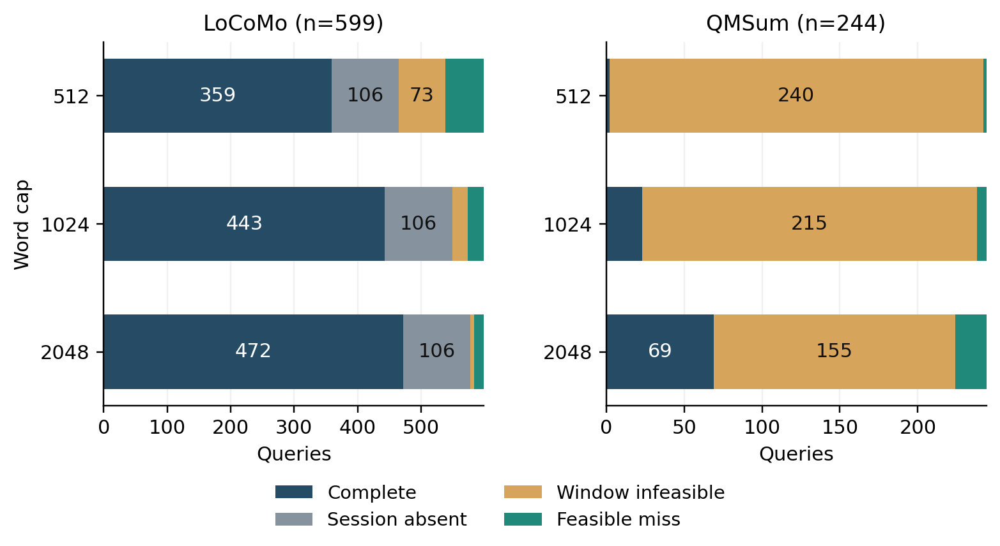
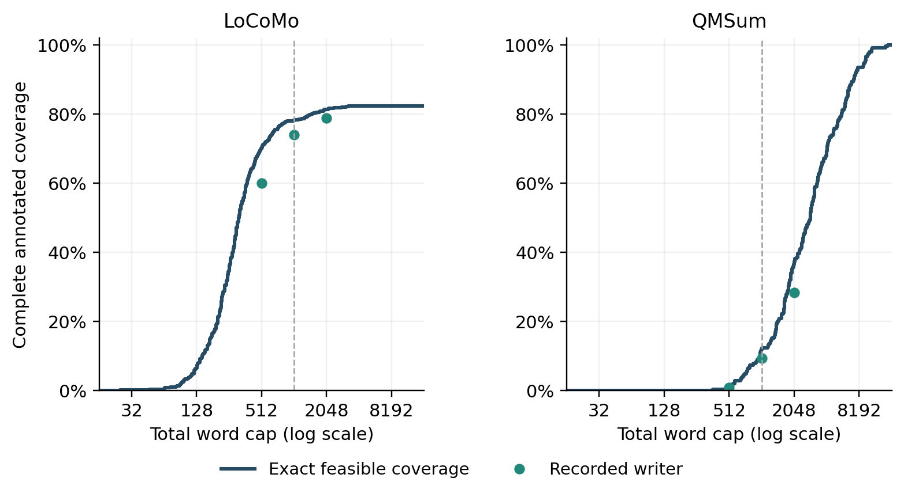

# امکان‌پذیری بازیابی شاهد در پنجره‌های ثابت

پژوهشگر: یوسف ابوالفتحی روزبهانی، کارشناسی مهندسی کامپیوتر، دانشگاه آزاد اسلامی واحد کرج. مرحله‌ی ۱۸، ۲۴ اکتبر ۲۰۲۶. مبنا: نسخه‌ی منتشرشده‌ی مرحله‌ی ۱۷ در commit 3da0b91.

## چکیده

این مرحله سقف بهبود ممکن در بازیابی شاهد را با همان لنگرها، پنجره‌های نامزد و هزینه‌ی مرحله‌ی ۱۷ محاسبه می‌کند. یک شرط لازم و کافی برای پوشش کامل واژه‌های شاهد و یک فرمول برای کمترین بودجه‌ی تخصیص نوبتی ارائه و پیاده‌سازی شد. تمام ۵۵۶۳۸ شرط تاریخی روی ۸۴۳ پرسش دوباره امتیاز گرفتند. در LoCoMo و سقف ۱۰۲۴ واژه، از ۱۵۶ شکست نویسنده، ۱۰۶ مورد به جلسه‌ی شاهد دسترسی ندارند، ۲۵ مورد در هندسه‌ی ثابت ناممکن‌اند و ۲۵ مورد پنجره‌ی موفق مجاز دارند. سقف تشخیصی ۴۶۸ از ۵۹۹ است؛ نویسنده‌ی موجود ۴۴۳ پرسش را پوشش می‌دهد. سقف بهبود میانگین مساوی گفت‌وگو ۴٫۱۹ واحد درصد، با بازه‌ی خوشه‌ای توصیفی ۲٫۹۶ تا ۵٫۱۳ است. در QMSum فقط ۲۹ پرسش از ۲۴۴ پرسش در همین سقف، امکان پوشش کامل همه‌ی بازه‌های مرتبط را دارند. این نتیجه به برچسب و فضای تعریف‌شده محدود است و دقت پاسخ را نمی‌سنجد. دو فایل عددی در بازاجرا یکسان تولید شدند؛ ۵۸ آزمون موفق و یک آزمون تاریخی کنارگذاشته‌شده از اجرا ثبت شد.

کلیدواژه‌ها: حافظه‌ی عامل، پوشش شاهد، امکان‌پذیری دقیق، کمترین بودجه، تحلیل شکست، بازیابی گفت‌وگو.

## ۱ اهمیت ضرورت و کاربرد پژوهش

تغییر یک مرزبند زمانی ارزش بررسی دارد که محدودیت‌های سامانه اجازه‌ی بهتر شدن را بدهند. در مرحله‌ی ۱۷ اثر نویسنده کوچک بود، اما نتیجه‌ی کلی مشخص نمی‌کرد کدام شکست با انتخاب پنجره‌ی بهتر قابل رفع است. حضور جلسه‌ی شاهد نیز کافی نبود؛ ممکن بود خود شاهد به دلیل فاصله از لنگر یا عرض کمِ پنجره وارد خروجی نشود. این ابهام می‌تواند زمان توسعه را به اصلاح بخشی اختصاص دهد که برای مسئله‌ی مورد نظر راه‌حل ندارد.

ممیز این مرحله برای هر پرسش یک پاسخ قابل بررسی می‌دهد: پوشش کامل در قرارداد فعلی ممکن است یا نیست و چه گواهی برای آن وجود دارد. کاربرد مستقیم، تصمیم درباره‌ی محل صرف منابع در یک سامانه‌ی بازیابی است. وقتی جلسه‌ی لازم غایب است، تغییر انتخاب متن داخل جلسه‌های موجود راه‌حل آن شکست نیست؛ وقتی پنجره‌ی موفق وجود دارد، بررسی انتخاب متن هنوز موضوع مشخصی برای پژوهش است. این نرم‌افزار روی CPU و بدون نمونه‌گیری انسانی یا API اجرا می‌شود و برای پروژه‌ی تک‌نفره قابل استفاده است.

## ۲ مرور پژوهش‌های مرتبط و دامنه‌ی تازگی

مرور هدفمند تا ۲۴ اکتبر، ۱۷ منبع اولیه را پوشش داد. هشت منبع در اطلس قبلی فهرست نشده بودند و نه منبع دوباره با سابقه‌ی مرحله‌ی ۱۷ پیوند خوردند. تازه‌ترین مدخل، پیش‌چاپ Raw-RAG در ۲۲ اکتبر است [S01]. وضعیت داوری هر اثر، نسخه، نویسندگان، دامنه‌ی مطالعه و هش صفحه در اطلس همراه ثبت شده است؛ منبع کنفرانسی با رتبه‌ی چارکی ژورنال معرفی نمی‌شود.

Raw-RAG بر حفظ متن خام و کنترل بودجه تاکید دارد؛ مقایسه‌های اوراکل آن نیز قواعد انتخاب و ارائه‌ی شاهد مشخص دارند [S01]. BFR ترکیب شاهد مکمل و دسترسی به رکوردهای بیرون از مجموعه‌ی نخست را تفکیک می‌کند [S02]. بنابراین اصل تشخیص نبود شاهد یا تحلیل oracle، ادعای تازه‌ی این پروژه نیست. ممیز ما به یک فضای کوچک‌تر محدود است و در همان فضا شرط دقیق می‌دهد.

دو مقاله‌ی مستقل با نام MemTrace باید از هم جدا شوند: اثر Long و همکاران روی دانش‌نقطه و شرایط شاهد است [S03]؛ اثر Deng و همکاران گراف عملیات و انتساب خطا را بررسی می‌کند [S04]. پژوهش FinanceBench نیز رسیدن به سند، صفحه و قطعه را تفکیک کرده است [S05]. Sufficient Context در ICLR 2025 کفایت معنایی زمینه را از استفاده‌ی خواننده متمایز می‌کند [S06]. پوشش واژه‌ایِ ما جای ارزیابی معنایی آن آثار را نمی‌گیرد.

SeCom، HingeMem، ReFind و مقایسه‌ی Fidelity Before Structure نیز برای بخش‌بندی، بازیابی از متن خام و کنترل مخدوش‌کننده‌ها پیشینه‌ی مستقیم‌اند [S11–S13،S17]. سهم محدود این مرحله، ممیز سازنده‌ی امکان در فرصت‌های دقیقا ثابت و فرمول کمترین بودجه‌ی همان سیاست تخصیص است. مطالعه‌ی حاضر تقدم جهانی این ترکیب یا بهبود یک بازیاب قابل استفاده را اثبات نمی‌کند.

## ۳ شرط دقیق امکان و کمترین بودجه

در هر پرسش، هشت نوبت اولِ نمایه‌ی نوبتی BM25 لنگرها را مشخص می‌کنند. ناحیه‌های وابسته به لنگر در هر جلسه غیرهم‌پوشان‌اند. هر پنجره باید در ناحیه‌ی خود بماند، واژه‌ی لنگر را بپوشاند و دقیقا عرض تخصیص‌یافته را مصرف کند. همه‌ی این اشیا از مرحله‌ی ۱۷ ثابت‌اند؛ برچسب مرجع پس از ساخت آن‌ها فقط وارد ممیز می‌شود.

برای هر ناحیه، کوچک‌ترین بازه‌ی شامل لنگر و تمام واژه‌های شاهد داخل همان ناحیه محاسبه می‌شود. عرض این بازه r است. اگر جلسه‌ای از شاهد لنگر نداشته باشد، پوشش کامل ممکن نیست. در غیر این صورت، پوشش کامل دقیقا وقتی ممکن است که عرض w هر پنجره دست‌کم r باشد. S_G مجموعه‌ی جلسه‌های شاهد و S_A مجموعه‌ی جلسه‌های دارای لنگر است؛ F نشانگر امکان پوشش کامل است.


ضرورت از پیوسته بودن پنجره به دست می‌آید: پنجره باید دو انتهای بازه‌ی لازم را بپوشاند. برای کفایت نیز وقتی عرض کافی است، یک شروع مجاز داخل ناحیه وجود دارد که همان بازه را در خود می‌گیرد. هر ناحیه مستقل انتخاب می‌شود و اجتماع پنجره‌ها تمام شاهد را می‌پوشاند. نوبتی که از مرز دو ناحیه عبور کرده باشد، به پوشش هر دو بخش نیاز دارد. مختصات پنجره‌ی موفق گواه امکان است؛ جلسه‌ی غایب یا ناحیه‌ی کم‌عرض، گواه عدم امکان است.

در تخصیص نوبتی، ناحیه‌ها به ترتیب رتبه یک واژه می‌گیرند و پس از پر شدن ظرفیت کنار می‌روند. برای رسیدن ناحیه‌ی i به عرض لازم r_i، ابتدا هر ناحیه‌ی j تعداد min(c_j,r_i−1) واژه در دورهای قبلی گرفته است؛ سپس ناحیه‌های فعال تا i در دور جاری نوبت می‌گیرند. بیشینه‌ی جایگاه این رویدادها کمترین بودجه‌ی کل است. c ظرفیت ناحیه و ترتیب j تا i همان ترتیب رتبه‌ی لنگرهاست.


این فرمول پس از ساخت بازه‌های لازم، برای k ناحیه زمان مرتبه‌ی k به توان دو می‌خواهد؛ اینجا k برابر هشت است. در بودجه‌ی محاسبه‌شده گواه موفق ساخته می‌شود و در یک واژه کمتر، دست‌کم یک شرط لازم برقرار نیست. برهان کامل و تعاریف نیمه‌باز در سند formal_contract آمده است. این بودجه، کمترین هزینه‌ی معنایی پاسخ یا بهترین تخصیص آزاد نیست.

## ۴ داده طرح ثبت‌شده و استنباط

طرح و تنظیمات در commit محلی daea6ca پیش از امتیازدهی مرحله‌ی ۱۸ ثبت شدند. کد و آزمون‌های مستقل در c8bde1d ثبت و سپس اجرا شدند. داده‌ها و نتیجه‌های قبلی معلوم بوده‌اند؛ این مطالعه اکتشافی است و ثبت عمومی مستقل یا آزمون تاییدی تازه محسوب نمی‌شود.

| داده | واحد و تعداد | معنای برچسب |
|---|---|---|
| LoCoMo | ۷ گفت‌وگو و ۵۹۹ پرسش قبلی | نوبت شاهد با الزام پوشش همه‌ی واژه‌ها |
| QMSum | ۳۵ جلسه و ۲۴۴ پرسش قبلی | اجتماع بازه‌های مرتبط با خلاصه‌سازی |

هش LoCoMo، نسخه و Git-blob فایل‌های QMSum، طرح و خروجی مرحله‌ی ۱۷ کنترل شدند [S08،S09]. شاهد خالی از مخرج پوشش کنار رفت و پرسش حفظ شد؛ همان پنج پرسش QMSum با مجموع نه مورد نوبت خالی باقی ماندند. نمایه، نقش‌های منبع، ناحیه‌ها و عرض‌ها بازساخته و با اثر انگشت شرایط تاریخی مقابله شدند.

واحد هزینه، شمار دنباله‌های پیوسته‌ی حروف، ارقام یا زیرخط با قواعد یونیکد در کد است؛ این بودجه تعداد توکن مدل زبانی را اندازه نمی‌گیرد.

برآورد اصلی، میانگین مساوی هفت گفت‌وگو از اختلاف امکان دقیق و موفقیت نویسنده در ۱۰۲۴ واژه است. بوت‌استرپ توصیفی ۲۰۰۰تایی با بذر۱۸ در سطح گفت‌وگو انجام شد. برای QMSum، ده خانواده‌ی منبع با حفظ جلسه‌هایشان واحد بازنمونه‌گیری‌اند. پرسش، بودجه و بذر نمونه‌ی مستقل فرض نشده‌اند. ۲۵۲۹ گروه و ۵۵۶۳۸ شرط، تکرار تحلیل روی همان ۸۴۳ پرسش‌اند.

قانون تصمیم پیش از اجرا، آستانه‌ی دو واحد درصد برای سقف بهبود میانگین گفت‌وگویی بود. مقدار کمتر، تغییر صرف انتخاب در این فرصت‌های ثابت را کم‌اولویت می‌کند؛ مقدار بالاتر فقط وجود ظرفیت ریاضی برای بررسی را نشان می‌دهد.

## ۵ یافته‌ی اصلی در سقف ۱۰۲۴ واژه

| وضعیت نویسنده | LoCoMo از ۵۹۹ | QMSum از ۲۴۴ |
|---|---:|---:|
| پوشش کامل ثبت‌شده | ۴۴۳ | ۲۳ |
| غیبت جلسه‌ی شاهد | ۱۰۶ | ۰ |
| ناممکن بودن با هندسه‌ی ثابت | ۲۵ | ۲۱۵ |
| شکست انتخاب با وجود پنجره‌ی موفق | ۲۵ | ۶ |
| سقف دقیق پوشش کامل | ۴۶۸ | ۲۹ |

چهار ردیف نخست افراز پرسش‌ها هستند؛ ردیف سقف جمع موفقیت‌ها و شکست‌های انتخابِ قابل حل است و دسته‌ی پنجمی نیست. در LoCoMo، ۱۳۱ مورد از ۱۵۶ شکست، یعنی حدود ۸۴ درصد، با تغییر صرف انتخاب در این فضای ثابت قابل رفع نیستند. ۲۵ مورد باقی‌مانده گواه موفق دارند. این تشخیص کدام اصلاح مهندسی را انتخاب کنیم محدود می‌کند، اما علت شناختی یا امکان پاسخ با شاهد جایگزین را مشخص نمی‌کند.

میانگین مساوی گفت‌وگو برای سقف دقیق ۷۸٫۳۸٪ و برای نویسنده ۷۴٫۱۹٪ است. فاصله‌ی ۴٫۱۹ واحد درصد، بازه‌ی خوشه‌ای توصیفی ۲٫۹۶ تا ۵٫۱۳ دارد. شمار ۲۵ از ۵۹۹، اختلافِ وزن‌دهی به پرسش است و لزوما با همین درصدِ وزن‌دهی مساوی به گفت‌وگو برابر نیست. روش مرکزی نیز ۴۴۲ موفقیت و ۲۶ شکست انتخابِ دارای امکان دارد.

در QMSum، سقف پوشش مشترک تمام بازه‌ی مرتبط ۲۹ مورد است و نویسنده ۲۳ مورد را می‌آورد. فاصله‌ی میانگین مساوی جلسه ۲٫۳۰ واحد درصد با بازه‌ی توصیفی صفر تا ۵٫۴۰ است. این خروجی فرعی با سنجه‌ی اصلی مرحله‌ی ۱۷ که «کسر نوبت‌های مرتبطِ کامل» بود متفاوت است؛ افت یا رشد آن سنجه از این جدول نتیجه نمی‌شود.

عدد ۴۶۸ عملکرد یک روش جدید نیست. ممیز به محل شاهد مرجع دسترسی دارد؛ یک بازیاب عملی چنین دسترسی‌ای ندارد و هنوز به این سقف نرسیده است. شباهت اتفاقی این شمار به عددی در مراحل گذشته نیز مقایسه‌ی معتبر نمی‌سازد؛ قرارداد و فضای خروجی این مرحله مشخص است.

## ۶ حساسیت به بودجه و حدود فضای فعلی

| سقف واژه | LoCoMo نویسنده | LoCoMo سقف دقیق | QMSum نویسنده | QMSum سقف دقیق |
|---|---:|---:|---:|---:|
| ۵۱۲ | ۳۵۹ | ۴۲۰ | ۲ | ۴ |
| ۱۰۲۴ | ۴۴۳ | ۴۶۸ | ۲۳ | ۲۹ |
| ۲۰۴۸ | ۴۷۲ | ۴۸۷ | ۶۹ | ۸۹ |

جدول شمار پرسش با پوشش کامل است. با بیشتر شدن بودجه، محدودیت عرض بعضی پرسش‌ها رفع می‌شود؛ غیبت جلسه‌ی شاهد در ۱۰۶ پرسش LoCoMo با این افزایش تغییر نمی‌کند. حتی در ۲۰۴۸ واژه نیز ۱۵ مورد در LoCoMo پنجره‌ی موفق مجاز دارند که نویسنده انتخاب نکرده است. در QMSum، تعداد زیاد موارد ناممکن به هدف پوشش کامل بازه‌های پهن مربوط است؛ از آن ناتوانی معنایی عامل نتیجه نمی‌گیریم.



رنگ موفقیت به خروجی ثبت‌شده‌ی نویسنده مربوط است؛ رنگ شکست انتخاب فقط وجود امکان ریاضی را نشان می‌دهد. اجزای باریک در شکل برچسب عددی ندارند و اعداد دقیق در JSON همراه هستند. برای QMSum معیار شکل، پوشش کامل مشترک همه‌ی نوبت‌های مرتبط است.

## ۷ سطح برچسب و کمترین بودجه

| معیار نویسنده در ۱۰۲۴ واژه | LoCoMo | QMSum |
|---|---:|---:|
| حضور همه‌ی جلسه‌های شاهد | ۴۹۳ | ۲۴۴ |
| برخورد حداقل یک واژه با هر نوبت شاهد | ۴۵۷ | ۳۸ |
| پوشش کامل همه‌ی نوبت‌های شاهد | ۴۴۳ | ۲۳ |

این سه سطح تعریف متفاوت دارند. گزارش حضور جلسه با عنوان پوشش کامل شاهد، ۵۰ پرسش LoCoMo را با نتیجه‌ی متفاوت نشان می‌دهد؛ حتی برخورد یک واژه با هر نوبت، در ۱۴ پرسش بیش از پوشش کامل است. این اختلاف، خودش خطای پاسخ یا نادرستی برچسب را ثابت نمی‌کند. در QMSum همه‌ی پرسش‌ها از یک جلسه‌ی در دسترس‌اند و معیار جلسه به‌تنهایی توان تشخیص بسیار محدودی دارد.

| آمار کمترین بودجه‌ی کل | LoCoMo | QMSum |
|---|---:|---:|
| پرسش با بودجه‌ی متناهی | ۴۹۳ | ۲۴۴ |
| میانه‌ی گروه متناهی | ۲۸۱ | ۲۸۸۹٫۵ |
| صدک ۹۰ گروه متناهی | ۶۴۱٫۲ | ۷۲۸۲٫۲ |
| بیشترین مقدار متناهی | ۳۲۶۲ | ۱۵۱۷۸ |

این توزیع به همان لنگر و تخصیص وابسته است. برای ۱۰۶ پرسشِ دارای جلسه‌ی غایب، بودجه‌ی متناهی تعریف نمی‌شود و آن‌ها از مخرج میانه کنارند. مقدار کسری در میانه یا صدک، حاصل درون‌یابی بین بودجه‌های صحیح است. بزرگ بودن اعداد QMSum درباره‌ی پهنای برچسب مرتبط و قرارداد پوشش کامل اطلاع می‌دهد؛ کمترین واژه‌ی لازم برای پاسخ واقعی محاسبه نشده است.



خط، توزیع محاسبه‌شده‌ی آستانه‌هاست و نقطه‌ها خروجی تاریخی نویسنده در سه بودجه‌اند؛ خواننده‌ی زبانی تازه‌ای در بودجه‌های روی خط اجرا نشده است. درصدهای شکل بر حسب پرسش‌اند و با میانگین مساوی گفت‌وگو در برآورد اصلی فرق دارند. بیشتر شدن ظرفیت پوشش، به‌تنهایی بهبود استفاده‌ی مدل از متن بلند را تضمین نمی‌کند [S16].

سه نمونه‌ی زیر برای توضیح گواه‌ها، پس از مشاهده‌ی نتیجه انتخاب شده‌اند؛ برآورد یا آزمون تازه نیستند. شناسه‌ی پرسش از صفر و مطابق فایل منبع است.

| نوع تشخیص در LoCoMo | تاریخچه و پرسش | کمترین بودجه |
|---|---|---:|
| جلسه‌ی شاهد غایب | conv-30 / 2 | تعریف‌نشده |
| عرض ناکافی در ۱۰۲۴ واژه | conv-30 / 26 | ۲۳۸۸ |
| پنجره‌ی موفق موجود ولی انتخاب‌نشده | conv-30 / 4 | ۸۵۳ |

در پرسش ۲، جلسه‌ی اول در دسترس نیست؛ افزایش عرض در جلسه‌های موجود آن را وارد مجموعه نمی‌کند. در پرسش ۲۶، ناحیه‌ی پنجم با شاخص ۴ در کد به عرض ۳۱۰ نیاز دارد ولی عرض تخصیص‌یافته ۱۲۸ است. در پرسش ۴، وجود پنجره‌ی پوشاننده‌ی شاهد از بودجه‌ی کل ۸۵۳ ممکن است، با این حال نویسنده در ۱۰۲۴ شکست خورده است. این نمونه‌ها تفاوت محدودیت امکان و شکست انتخاب را نشان می‌دهند؛ پاسخ زبانی تولید نشده است.

## ۸ کیفیت اجرا و بازتولید

هفت آزمون مرحله‌ی ۱۸ اجرا شدند. یکی از آن‌ها برای ۲۴۰ هندسه‌ی کوچک با بذر ثابت، تمام ترکیب‌های پنجره‌ی مجاز را در هر بودجه جست‌وجو می‌کند و با فرمول می‌سنجد؛ این جست‌وجو روی همه‌ی هندسه‌های ممکن جهان نیست. آزمون‌های دیگر، جلسه‌ی غایب، نوبت عبوری از مرز، اشباع ظرفیت، شاهد خالی و ناسازگاری موفقیت با کران را کنترل می‌کنند. نمونه‌های مصنوعی فقط آزمون صحت‌اند و بنچمارک تجربی گفت‌وگو معرفی نشده‌اند.

مجموعه‌ی کامل، ۵۹ آزمون داشت: ۵۸ موفق و یک آزمون قدیمی مرحله‌ی ۱۴ به دلیل نبود کپی محلی Memora کنار گذاشته شد. اعتبارسنج ۷۳۷ آستانه‌ی متناهی و ۱۴۹۷ گواه موفقِ پرسش–بودجه را بررسی کرد. همه‌ی شرایط تاریخی با امتیازدهنده‌ی قبلی از روی منبع دوباره سنجیده شدند و هیچ موفقیتی از کران دقیق بیشتر نبود. اعتبارسنج قابل حمل، گواه هندسی را بدون متن خام می‌سنجد؛ معنای برچسب باید از منبع احراز شود.

اجرای اصلی حدود ۷٫۲۱ ثانیه و بازاجرا ۷٫۲۷ ثانیه زمان داشت؛ اوج حافظه‌ی فرایند اصلی حدود ۳۳۵٫۷۲ MiB بود. هر دو فایل عددی در بازاجرا بایت‌به‌بایت یکسان شدند. این زمان فقط اجرای محاسباتی و کنترل‌های همان اسکریپت است و زمان مرور مقاله، نگارش و ساخت گزارش را در بر نمی‌گیرد. آزمایش فراخوانی API تجاری نداشت.

## ۹ محدودیت و تفسیر شناختی

کران نسبت به تمام واژه‌های نوبت‌های مرجع دقیق است. اگر پاسخ با تکرار دیگری از یک واقعیت، با استنباط از متن متفاوت یا با زیرمجموعه‌ی کوتاه‌تری ممکن باشد، این ممیز آن امکان معنایی را مدل نمی‌کند. از طرف دیگر، حضور همه‌ی واژه‌های مرجع نیز پاسخ صحیح را تضمین نمی‌کند. «شاهد برچسبی»، «شاهد معنایی» و «استفاده‌ی خواننده» باید جدا سنجیده شوند [S03–S06].

هفت گفت‌وگوی LoCoMo و داده‌های QMSum در فازهای قبلی دیده شده‌اند. یک رتبه‌بند واژگانی و یک سیاست تخصیص بررسی شده است؛ تغییر نمایه، لنگر، عرض، تعداد پنجره یا امکان گذر از مرز ناحیه، فضای دیگری می‌سازد و کران حاضر به آن تعمیم داده نمی‌شود. ۱۱ جفت تاریخچه–بذرِ دارای قطعه‌ی فقط نوبت خالی در مرحله‌ی ۱۷ بازنویسی نشده‌اند؛ ممیز به پارتیشن داخلی وابسته نیست و همان فرصت‌های مشترک را می‌سنجد.

پژوهش انسانی قطعه‌بندی رویداد، خطای پیش‌بینی و عدم قطعیت را در زمینه‌ی شناخت و پاسخ عصبی بررسی می‌کند [S14]. نویسنده‌ی فعلی جانشین واژگانی است و ممیز حاضر هندسه‌ی متن را می‌سنجد. هیچ نتیجه‌ای درباره‌ی ادراک اپیزودیک، سازوکار عصبی یا فهم معنا در معنای فلسفی بحث سرل از این مرحله استخراج نمی‌شود.

## ۱۰ تصمیم پژوهشی و مسیر ادامه

سقف ۴٫۱۹ واحد درصد از آستانه‌ی دو واحد درصد بیشتر است؛ طبق قانون از پیش ثبت‌شده، برای بررسی انتخاب پنجره هنوز ظرفیت محدود وجود دارد. این نتیجه، موفقیت هیچ روش تازه‌ای را تضمین نمی‌کند. در عین حال حدود ۸۴ درصد شکست‌های فعلی، در همین فضای انتخاب قابل رفع نیستند؛ ادعای بهبود چشمگیر با تغییر صرف مرزبند باید با این محدودیت سازگار باشد.

گام بعد باید یک سوال محدود از میان تغییر دسترسی به جلسه، تخصیص زمینه یا انتخاب درون فضای موجود را انتخاب کند و پیش از اجرا طرح جدا داشته باشد. داده‌ی دارای شاهد ریزتر یا ساخت کنترل‌شده با سازنده و بذر معلوم می‌تواند اعتبار سازه را بهتر بررسی کند. EverMemBench و MemTrace مبتنی بر دانش‌نقطه برای بررسی داده‌ی آینده مرتبط‌اند [S03،S07]؛ در این مرحله داده‌ی آن‌ها اجرا نشده و استقلال، مجوز و هزینه هنوز باید جدا احراز شوند. LongMemEval قبلی نیز داده‌ی دست‌نخورده‌ی تازه نیست [S10].

برای تحویل کارشناسی، محصول فعلی یک ابزار پژوهشیِ واقعی با ورودی مشخص، گواه، آزمون و خروجی قابل بازتولید است. نگارش فصل روش، نتایج و محدودیت‌ها می‌تواند بر همین خروجی‌ها تکیه کند. افزودن معماری پرهزینه پیش از تعیین فرصت شناسایی اثر توجیه ندارد [S15].

## ۱۱ راهنمای استفاده و بازبینی

کد اصلی scripts/run_phase18_feasibility.py است. scripts/validate_phase18.py گواه‌های ثبت‌شده را می‌سنجد و scripts/analyze_phase18.py شکل‌ها و تفکیک‌ها را می‌سازد. نتیجه‌ی تفصیلی در دو فایل phase18_queries.json.gz و phase18_rows.json.gz، و جمع‌بندی در phase18_summary.json است. هیچ متن پرسش، پاسخ یا مکالمه در خروجی عددی نیست.

پس از دریافت نسخه‌ی گیت و داده‌های رسمی، اجرای زیر باید در یک مسیر تازه انجام شود:

```bash
python scripts/run_phase18_feasibility.py --output-dir /tmp/phase18-reproduction
python scripts/validate_phase18.py --directory /tmp/phase18-reproduction
```

راهنمای کامل، قرارداد رسمی، اطلس منابع، نقد تازگی و گواه بازتولید همراه بسته‌اند. مجوز داده‌ها از منبع اصلی رعایت می‌شود و فایل مقاله، کتاب یا قلم بازتوزیع نمی‌شود.

## ۱۲ سپاسگزاری

از استاد امیر نوری، راهنمای دانشگاهی پروژه، برای هدایت علمی و حمایت از ایده‌های نو سپاسگزارم. از دکتر آرش فکری، بنیان‌گذار فردیت (FARDIAT)، مجتمع فوق تخصصی مغز و شناخت و استاد من در علوم اعصاب شناختی، برای آموزش‌ها و بررسی و تایید پروپوزال سپاسگزارم.
