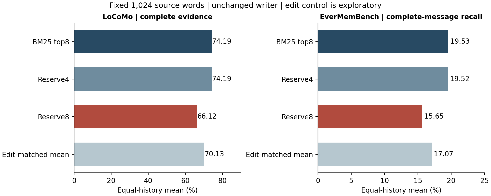
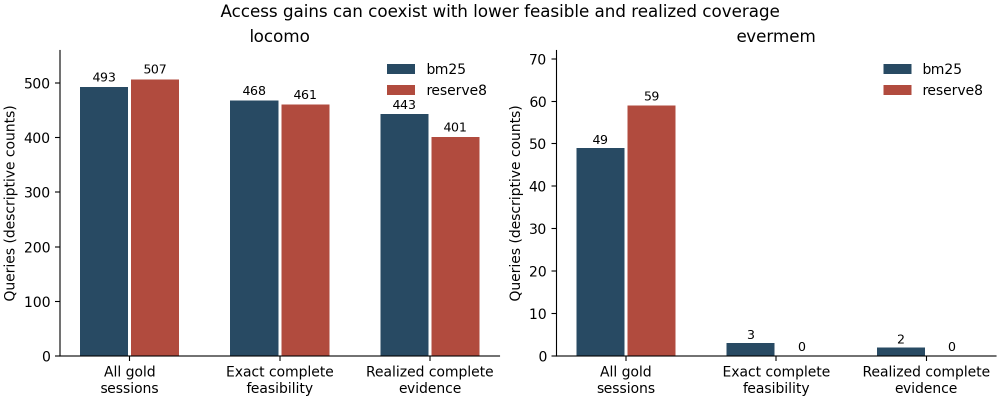
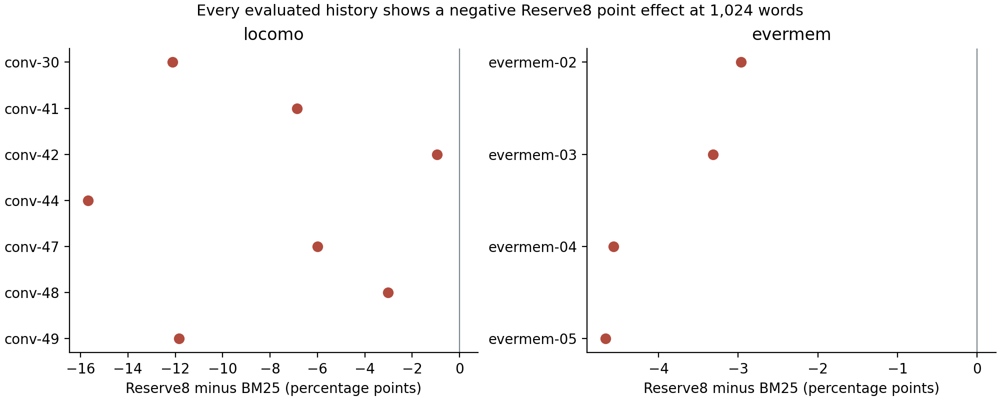

# گزارش پژوهشی مرحله‌ی ۱۹

## چکیده

این مرحله بررسی می‌کند که آیا افزایش تنوع جلسه‌های منتخب، با همان سقف واژه، پوشش شاهد را بهتر می‌کند. دلیل انتخاب سوال، یافته‌ی مرحله‌ی ۱۸ بود: از ۱۵۶ شکست بازیاب اصلی در LoCoMo، ۱۰۶ مورد به جلسه‌ی شاهد دسترسی نداشتند. در این مرحله هشت لنگر از همان نمایه‌ی BM25 انتخاب می‌شوند؛ روش اصلی چهار نماینده از جلسه‌های متفاوت رزرو می‌کند و کنترل دوز، هشت جلسه را ترجیح می‌دهد. هندسه و کران دقیق برای هر انتخاب از نو محاسبه می‌شوند.

داده شامل ۵۹۹ پرسش بازاستفاده‌شده از هفت گفت‌وگوی LoCoMo و ۶۰۹ پرسش ریزدانه از چهار پروژه‌ی EverMemBench-Dynamic است. موضوع قالب‌شناسی از ارزیابی کنار گذاشته شد. روش چهارجلسه‌ای در LoCoMo بهبود نداشت و در منبع بیرونی نیز اثر آن نزدیک صفر و اندکی منفی بود. روش هشت‌جلسه‌ای دسترسی به جلسه‌های مرجع را بیشتر کرد، ولی پوشش کامل LoCoMo از ۴۴۳ به ۴۰۱ پرسش و میانگین پوشش کامل پیام‌های مرجع بیرونی از ۱۹٫۵۳ به ۱۵٫۶۵ درصد افت کرد.

کنترل اولیه تقریبا انتخاب‌ها را تغییر نمی‌داد؛ بنابراین پس از مشاهده‌ی نتیجه، تحلیل اکتشافی جداگانه‌ای با تعداد تعویض لنگر برابر ثبت و اجرا شد. روش هشت‌جلسه‌ای از این کنترل هم پوشش متن کمتری داشت، با وجود دسترسی بیشتر به جلسه‌های مرجع. سهم محدود پژوهش، تفکیک قابل بازرسی دسترسی از ظرفیت پوشش، مدل ترکیبی دقیق برای کنترل و گواه‌های عددی بازتولیدپذیر است. این مرحله بهبود عملی یک بازیاب تازه یا صحت پاسخ تولیدشده را نشان نمی‌دهد.

## ۱ اهمیت و ضرورت پژوهش

وقتی شاهد اصلا به فضای انتخاب وارد نشده باشد، تغییر مرز پنجره به‌تنهایی آن را برنمی‌گرداند. از سوی دیگر، ورود به جلسه‌ی درست نیز تضمین نمی‌کند که پنجره‌ی کافی از آن جلسه کنار گذاشته شود. در بودجه‌ی محدود، یک لنگر اضافی در جلسه‌ای تازه ممکن است جای لنگری را بگیرد که برای گردآوری چند پیام مرتبط از یک جلسه لازم بوده است. تصمیم مهندسی میان پخش جست‌وجو و حفظ پوشش محلی، نیاز به آزمون و ممیزی دارد.

کاربرد مستقیم این تحلیل، تصمیم درباره‌ی حافظه‌ی دستیارهای گفت‌وگویی، جست‌وجوی تاریخچه‌ی پشتیبانی و بازیابی از گفت‌وگوهای پروژه است. ممیز نشان می‌دهد هزینه‌ی توسعه باید صرف گسترش نامزدها، تغییر تخصیص زمینه یا بهترکردن انتخاب پنجره شود. این کاربرد در همین قرارداد و برچسب‌های موجود معتبر است؛ تبدیل آن به محصول پاسخ‌گو به آزمون تولید پاسخ و داده‌ی کاربرد واقعی نیاز دارد.

## ۲ پیشینه و شکاف مشخص

تنوع‌بخشی پیشینه‌ی مستقیم در MMR دارد [R01]. SeCom دانه‌بندی موضوعی حافظه را بررسی کرده است [R04]. BFR نیز شاهد مکمل و دسترسی به رکوردهای بیرون از مجموعه‌ی نخست را مطرح می‌کند [R02]. Raw-RAG اهمیت حفظ متن خام و مبنای ساده‌ی قوی را نشان می‌دهد [R03]. بنابراین ایده‌ی تنوع یا شکاف شاهد در این مرحله به‌عنوان اختراع تازه معرفی نمی‌شود.

MemDerive از گراف مرجع برای تشخیص شکست حالت مشتق‌شده استفاده می‌کند [R05]؛ DyadMem مراحل ثبت و به‌روزرسانی و فراخوانی حافظه را جدا می‌سنجد [R06]. پژوهش گراف حافظه و پژوهش زمینه‌ی فیلترشده نیز فاصله‌ی پوشش شاهد با کیفیت پاسخ نهایی را روشن می‌کنند [R07 و R08]. اعداد این مقالات به دلیل سنجه و بودجه و خواننده‌ی متفاوت، با این گزارش رتبه‌بندی نمی‌شوند. روش‌های آن‌ها در این مرحله بازاجرا نشده‌اند.

شکاف عملی انتخاب‌شده این است: در یک نمایه و سقف متن مشترک، تغییر گروه لنگرها چه اثری بر دسترسی، امکان دقیق پوشش و پوشش واقعی دارد، و آیا کنترل به اندازه‌ی خود مداخله انتخاب را تغییر داده است؟ محصول این مرحله یک آزمون محدود از این رابطه با ثبت زمانی روشن، منبع بیرونی و کنترل همسان از نظر تعداد تعویض است. ادعای تقدم جهانی برای این ترکیب مطرح نمی‌شود.

پژوهش eLife میان خطای پیش‌بینی و عدم قطعیت پیش‌بینی در مرزبندی رویداد انسانی تمایز می‌گذارد [R11]. در این اجرا، جلسه یا روز و گروه، واحد اداری داده است و مرز رویدادی انسان فرض نمی‌شود. نویسنده‌ی موجود نیز شاخص تازگی واژگانی دارد. سوال فلسفی معنا در اتاق چینی و سازوکار عصبی ادراک، متغیر اندازه‌گیری‌شده‌ی این آزمایش نیستند.

## ۳ داده و پذیرش منبع تازه

LoCoMo همان فهرست ثابت مرحله‌ی نخست است و پس از استفاده‌های قبلی، آزمون مستقل تازه محسوب نمی‌شود [R10]. در منبع بیرونی، نسخه و اثر انگشت هشت فایل پیش از دریافت محتوای چهار موضوع ارزیابی ثابت شد. موضوع ۰۱ و فایل قدیمی ۰۰۴ برای شناخت قالب دیده شدند و امتیازدهی نشدند. چهار موضوع ۰۲ تا ۰۵، ۱۹۱۲ پرسش منتشرشده داشتند؛ طبق دامنه‌ی ثبت‌شده، ۱۳۰۳ پرسش بیرون از خانواده‌ی F_ کنار گذاشته شدند و هر ۶۰۹ پرسش ریزدانه وارد شدند. هیچ پرسش داخل این دامنه به دلیل ارجاع حل‌نشده یا پیام خالی حذف نشد.

| ویژگی | LoCoMo | EverMemBench |
|---|---|---|
| تاریخچه‌ی ارزیابی | ۷ گفت‌وگو | ۴ پروژه‌ی ساخته‌شده |
| پرسش واردشده | ۵۹۹ | ۶۰۹ |
| تعریف جلسه | جلسه‌ی منتشرشده | هر روز و گروه |
| میانه‌ی پیام مرجع | ۱ | ۲۹ |
| میانه‌ی واژه‌ی مرجع | ۳۴ | ۱۴۳۵ |
| پرسش با بیش از ۸ جلسه‌ی مرجع | ۰ | ۲۳۶ |

ارجاع‌های بیرونی با تاریخ، گروه و message_index منبع حل شدند؛ شماره‌ی پیام با جایگاه آرایه یکسان فرض نشد. بازه‌ها به‌صورت سخت‌گیرانه باز و شناسه‌های تکراری حذف شدند. تمام پیام‌های حواس‌پرت‌کننده‌ی منتشرشده در نمایه باقی ماندند. کارت نسخه‌ی ثابت، مجوز Apache 2.0 را اعلام می‌کند [R09]. متن خام و پاسخ‌ها در ریپو و بسته بازتوزیع نمی‌شوند.

هیچ پیام یکسانِ نرمال‌شده با دست‌کم ۱۲ واژه میان تاریخچه‌های ارزیابی یا میان موضوع قالب‌شناسی و چهار پروژه یافت نشد. این بررسی فقط همسانی دقیق را می‌سنجد و استقلال معنایی یا استقلال فرایند تولید را اثبات نمی‌کند. چهار پروژه از یک فرایند ساخت مشترک می‌آیند؛ تعداد زیادی پرسش، جای تعداد کم تاریخچه‌های مستقل را نمی‌گیرد.

## ۴ الگوریتم و قرارداد هزینه

برای هر پرسش، BM25 فقط یک بار همه‌ی نوبت‌های غیرخالی را رتبه‌بندی می‌کند. ۶۴ رتبه‌ی نخست، مجموعه‌ی نامزد مشترک است. مبنا هشت نوبت نخست را برمی‌گزیند. روش رزرو چهار جلسه، نخستین نماینده‌ی چهار جلسه‌ی متفاوت را نگه می‌دارد و باقی هشت لنگر را از ترتیب اصلی پر می‌کند. کنترل دوز همین کار را با هشت جلسه انجام می‌دهد. پس از انتخاب، ترتیب رتبه‌ی اصلی بازگردانده می‌شود تا ترتیب تخصیص واژه متغیر دیگری نشود.

اگر در مجموعه‌ی نامزد S گروه باشد، رزرو r گروه دست‌کم کوچک‌ترِ r و S را نمایندگی می‌کند، رتبه‌ی نخست را نگه می‌دارد و حداکثر r منهای یک عضو از هشت رتبه‌ی اصلی را تعویض می‌کند. دلیل آن، حفظ نماینده‌های رزروشده و پرشدن باقی جایگاه‌ها از ترتیب اصلی است. این تضمین مربوط به گروه‌هاست و برای پوشش شاهد تضمینی ندارد. وقتی فقط یک جلسه وجود دارد، همه‌ی سیاست‌ها به همان هشت رتبه‌ی نخست برمی‌گردند.

پس از انتخاب لنگر، همان ناحیه‌های میانی و تخصیص نوبتی مرحله‌ی ۱۷ استفاده می‌شوند. دو انتخابگر مرکزی و نویسنده، درون هر سیاست ناحیه و عرض و هزینه‌ی برابر دارند. نویسنده همان نسخه‌ی علیِ مرحله‌ی هشتم با حداقل ۶۴، حداکثر ۱۶۰ واژه و آستانه‌ی تازگی ۰٫۸۵ است؛ هنگام ساخت قطعه آینده را نمی‌بیند، ولی بازیابی پس از کامل‌شدن تاریخچه انجام می‌شود.

هزینه تعداد واقعی واژه‌های یکتای متن پیام است؛ پیشوند نقش و زمان در متن نمایه وارد نمی‌شود. بودجه‌ها ۵۱۲، ۱۰۲۴ و ۲۰۴۸ واژه‌اند. میان سیاست‌ها ناحیه و ظرفیت ممکن است عوض شود؛ ازاین‌رو سقف امکان و کمترین بودجه جدا محاسبه می‌شوند. سقف ۴۶۸ مرحله‌ی ۱۸ به سیاست تازه منتقل نمی‌شود. در بودجه‌ی اصلی ۱۰۲۴، همه‌ی مقایسه‌ها دقیقا ۱۰۲۴ واژه مصرف کردند. موارد اشباع در بودجه‌ی ثانویه صریح ثبت شده‌اند.

برای پوشش کامل باید تمام واژه‌های همه‌ی پیام‌های مرجع غیرخالی در اتحاد پنجره‌ها باشند. کران تشخیصی نیز همین قرارداد برچسبی را می‌سنجد. این کران، کفایت معنایی یا دقت پاسخ را کران‌بندی نمی‌کند. پژوهش TACL نشان می‌دهد حتی وجود شاهد در زمینه نیز با استفاده‌ی درست خواننده یکی نیست [R12].

## ۵ طرح تحلیل و ثبت زمانی

طرح اصلی در commit محلی 58418d8 پیش از امتیازدهی جدید و پیاده‌سازی در f84a2ce پیش از نخستین اجرا ثبت شد. ثبت محلی، پیش‌ثبت عمومی مستقل نیست. پارامتر اصلی پس از مشاهده‌ی امتیازها تغییر نکرد. LoCoMo دیده‌شده باقی ماند؛ چهار موضوع بیرونی در این چرخه پس از تثبیت طرح باز شدند.

مقایسه‌ی اصلی فقط رزرو چهار جلسه در برابر مبنا، با نویسنده و ۱۰۲۴ واژه است. در LoCoMo، معیار پوشش کامل همه‌ی نوبت‌های مرجع و در منبع بیرونی، سهم پیام‌های مرجع کاملا پوشیده است. ابتدا میانگین پرسش‌ها در هر تاریخچه و سپس میانگین بدون وزن تاریخچه‌ها گرفته می‌شود. این دو معیار به‌صورت جدا گزارش می‌شوند و در یک اندازه‌اثر ادغام نمی‌شوند.

قاعده‌ی ازپیش‌ثبت‌شده‌ی اولویت ادامه، بهبود حداقل دو واحد درصد در هر دو منبع، جهت غیرمنفی در حذف تک‌تاریخچه و برتری نقطه‌ای بر میانگین پنج کنترل درهم‌ریخته بود. این قاعده تامین نشد. کنترل هشت‌جلسه‌ای، انتخابگر مرکزی، بودجه‌های دیگر و فاصله‌های بوت‌استرپ، تحلیل ثانویه‌اند. بازنمونه‌گیری روی تاریخچه است؛ نه پرسش و نه بذر، واحد مستقل جدید محسوب نمی‌شود.

## ۶ نتیجه‌ی اصلی

در LoCoMo روش چهارجلسه‌ای فقط در ۸ پرسش از ۵۹۹ پرسش لنگر را عوض کرد؛ در منبع بیرونی این تعداد یک پرسش از ۶۰۹ بود. پس نتیجه‌ی نزدیک صفر، شاهد آزمودن یک مداخله‌ی قوی در همه‌ی پرسش‌ها نیست. پنج کنترل جایگشت نیز در مجموع فقط دو حالت پرسش و بذر LoCoMo را تغییر دادند و در منبع بیرونی بی‌تغییر ماندند. این محدودیت کنترل، پس از نتیجه آشکار و در اصلاحیه ثبت شد.

| سیاست با نویسنده در ۱۰۲۴ واژه | پوشش کامل LoCoMo | میانگین تاریخچه‌ای LoCoMo | پوشش کامل پیام بیرونی |
|---|---|---|---|
| هشت رتبه‌ی نخست | 443 از ۵۹۹ | 74.19 درصد | 19.53 درصد |
| رزرو چهار جلسه | 443 از ۵۹۹ | 74.19 درصد | 19.52 درصد |
| رزرو هشت جلسه | 401 از ۵۹۹ | 66.12 درصد | 15.65 درصد |
| میانگین کنترل تعویض همسان اکتشافی | میانگین ده کنترل | 70.13 درصد | 17.07 درصد |

رزرو چهار جلسه در LoCoMo صفر واحد درصد و در معیار بیرونی حدود ۰٫۰۱ واحد درصد افت داشت. در مقابل، رزرو هشت جلسه نسبت به مبنا در LoCoMo حدود ۸٫۰۷ و در منبع بیرونی ۳٫۸۸ واحد درصد افت کرد. جهت اثر هشت‌جلسه‌ای در تک‌تک هفت گفت‌وگو و چهار پروژه منفی بود. این مشاهده دامنه‌ی همین داده‌ها را توصیف می‌کند و آزمون معنی‌داری یازده تکرار همسان نیست.

فاصله‌ی توصیفی ۹۵ درصد برای اثر هشت‌جلسه‌ای نسبت به مبنا در LoCoMo حدود منفی ۱۱٫۶۸ تا منفی ۴٫۵۸ واحد درصد و در منبع بیرونی منفی ۴٫۶۲ تا منفی ۳٫۱۴ بود. چهار پروژه برای استنباط تعمیم وسیع کافی نیستند. مقدار صفر در روش چهارجلسه‌ای همراه با کنترل تغییر انتخاب تفسیر می‌شود، نه به‌عنوان اثبات بی‌اثر بودن همه‌ی انواع تنوع.

## ۷ دسترسی و امکان پوشش

| سطح در ۱۰۲۴ واژه | مبنای LoCoMo | رزرو هشت LoCoMo | مبنای بیرونی و رزرو هشت |
|---|---|---|---|
| همه‌ی جلسه‌های مرجع حاضر | ۴۹۳ | ۵۰۷ | ۴۹ و ۵۹ |
| پوشش کامل از نظر هندسه ممکن | ۴۶۸ | ۴۶۱ | ۳ و صفر |
| پوشش کامل عملا به دست آمده | ۴۴۳ | ۴۰۱ | ۲ و صفر |

در LoCoMo، ۱۴ پرسش به همه‌ی جلسه‌های شاهد دسترسی تازه پیدا کردند و هیچ پرسش در این سطح دسترسی را از دست نداد. با این حال، ۱۸ پرسش امکان هندسی قبلی را از دست دادند و فقط ۱۱ پرسش امکان تازه یافتند. در پوشش واقعی، ۵۱ موفقیت قبلی از دست رفت و ۹ موفقیت تازه به دست آمد. پس رشد دسترسی به‌تنهایی، جانشین سنجش شاهد کامل نیست.

برای نمونه‌ی توضیحیِ پس از نتیجه، در conv-30 پرسش ۱۲، مبنا موفق است و کمترین بودجه‌ی هندسی آن ۲۸۵ است. با رزرو هشت جلسه، همه‌ی جلسه‌های لازم همچنان حاضرند، ولی یک ناحیه برای پوشش مرجع به عرض ۱۳۵ نیاز دارد و فقط ۱۲۸ می‌گیرد. کمترین بودجه‌ی همان سیاست به ۱۰۷۳ می‌رسد و نتیجه در ۱۰۲۴ ناممکن می‌شود. در پرسش ۹ همان گفت‌وگو، دسترسی تازه حاصل می‌شود ولی بودجه‌ی دقیق لازم ۲۵۰۲ است؛ عرض لازم ۳۱۳ در یک ناحیه در برابر ۱۲۸ واژه‌ی تخصیص‌یافته قرار می‌گیرد. این مثال‌ها برای توضیح انتخاب شده‌اند و نمونه‌ی آزمون مستقل نیستند.

## ۸ کنترل تکمیلی و انتظار ترکیبی دقیق

پس از مشاهده‌ی ضعف کنترل جایگشت، اصلاحیه‌ی اکتشافی در 999ac22 و پیاده‌سازی آن در dc9b58e ثبت شد. در هر پرسش، تعداد d تعویض روش هشت‌جلسه‌ای محاسبه می‌شود. کنترل، رتبه‌ی نخست را حفظ می‌کند، ۷ منهای d مورد از هفت لنگر دیگر و d مورد از ۵۶ رتبه‌ی بیرونی را یکنواخت و بدون جایگذاری انتخاب می‌کند. ده بذر ثابت استفاده شده و میانگین آن‌ها داخل پرسش گرفته می‌شود. تعداد تعویض‌ها برابر است؛ امتیاز BM25 و کیفیت معنایی لزوما برابر نیستند.

برای زیرمجموعه‌ای از جلسه‌های مرجع، احتمال این‌که هیچ لنگر منتخب وارد آن نشود از حاصل‌ضرب دو نسبت تعداد ترکیب‌ها به دست می‌آید. اگر جلسه‌ی رتبه‌ی نخست در آن زیرمجموعه باشد، این احتمال صفر است. با شمول و عدم شمول، احتمال دقیق دسترسی به همه‌ی جلسه‌ها محاسبه می‌شود. این انتظار روی زیرمجموعه‌های لنگر، خطای مونت‌کارلو ندارد؛ احتمال درست‌بودن پاسخ یک مدل نیست. برچسب مرجع فقط وارد این محاسبه‌ی آفلاین می‌شود.

در LoCoMo، دسترسی هشت‌جلسه‌ای حدود ۴٫۲۵ واحد درصد بالاتر از انتظار ترکیبی کنترل است، اما پوشش کامل آن ۴٫۰۱ واحد درصد از میانگین ده کنترل کمتر است. در منبع بیرونی، اختلاف دسترسی نسبت به انتظار دقیق حدود مثبت ۳٫۷۱ و اختلاف پوشش پیام نسبت به کنترل‌ها منفی ۱٫۴۲ واحد درصد است. این دو اختلاف، سنجه‌های متفاوتی دارند. مقایسه‌ی تکمیلی اکتشافی است و شکست قاعده‌ی اصلی را تغییر نمی‌دهد.

در بودجه‌ی ثانویه‌ی ۲۰۴۸، ۵۷ حالت پرسش و بذر LoCoMo و یک حالت بیرونی در کنترل تعویض، ظرفیت کامل نداشتند. این تعداد برای انتخابگر نویسنده است؛ دو انتخابگر همان هزینه را دارند. در بودجه‌ی اصلی و ۵۱۲ چنین اختلافی نبود. پس برابری هزینه‌ی دقیق برای مقایسه‌ی اصلی برقرار است و به همه‌ی شرایط ثانویه تعمیم داده نمی‌شود.

## ۹ دانه‌بندی مرجع و تفسیر بیرونی

در مجموعه‌ی بیرونی، ۴۳۱ پرسش از ۶۰۹ پرسش بیش از ۱۰۲۴ واژه‌ی مرجع دارند؛ پوشش کامل این برچسب‌ها با این سقف، مستقل از کیفیت انتخاب متن، ممکن نیست. همچنین ۲۳۶ پرسش بیش از هشت جلسه‌ی مرجع دارند و با هشت لنگر نمی‌توان همه‌ی آن جلسه‌ها را نمایندگی کرد. این‌ها محدودیت سنجه‌ی پوشش کامل در این قراردادند و به معنای ناممکن بودن پاسخ معنایی نیستند. کارت داده تصریح می‌کند که مرجع شامل قطعه‌ی زمینه‌ای پیرامون جواب نیز هست [R09].

از ۶۰۹ پرسش، فقط در ۱۸۵ مورد همه‌ی جلسه‌های مرجع در مجموعه‌ی ۶۴ نامزد حاضرند. برای LoCoMo این شمار ۵۸۶ از ۵۹۹ است. حضور در نامزدها فقط شرط لازم است و با امکان پوشش در هشت پنجره یکی نیست. این تفاوت، اهمیت عمق نامزد و دانه‌بندی روز و گروه را در تفسیر انتقال نشان می‌دهد. درصد معیار اصلی LoCoMo با درصد معیار بیرونی، اندازه‌گیری یک پدیده‌ی همسان نیست.

## ۱۰ اعتبارسنجی و بازتولید

هر ۳۵۹۴ حالت مبنای مرکزی و نویسنده‌ی تاریخی LoCoMo دقیقا بازتولید شد. ممیز مستقل، پنجره‌ها را با اتحاد بازه‌ها دوباره امتیاز داد و هم‌پوشانی یا دوباره‌شماری واژه را رد کرد. گزینش متن هیچ کانال پاسخ و مرجع ندارد؛ آزمون تغییر فیلدهای مسموم QA، این جداسازی را کنترل می‌کند. تغییر نام جلسه، انتخاب را تغییر نمی‌دهد و کنترل تک‌جلسه‌ای به مبنا برمی‌گردد.

| کنترل صحت | بخش اصلی | بخش تکمیلی |
|---|---|---|
| پرسش‌های یکتا | ۱۲۰۸ مشترک | همان ۱۲۰۸ |
| حالت پرسش و سیاست و انتخابگر و بودجه | ۵۷۹۸۴ | ۷۲۴۸۰ |
| آستانه‌ی بودجه‌ی متناهی کنترل‌شده | ۴۳۶۰ | ۵۱۸۸ |
| گواه امکان با امتیازدهی دوباره | ۱۱۰۵۷ | ۱۳۲۰۸ |
| گروه هزینه‌ی دو انتخابگر برابر | ۲۸۹۹۲ | ۳۶۲۴۰ |

مجموعه‌ی کامل ۷۰ آزمون دارد: ۶۹ موفق و یک آزمون تاریخی مرحله‌ی ۱۴ به دلیل نبود داده‌ی محلی پین‌شده اجرا نشد. هر ۱۱ آزمون این مرحله اجرا و موفق شد. انتظار ترکیبی روی ۷۶۸ تنظیم کوچک با شمارش تمام زیرمجموعه‌های مجاز مقایسه شد؛ این تنظیم‌ها آزمون صحت‌اند و مجموعه‌داده‌ی گفت‌وگو یا نمونه‌ی پژوهشی تازه نیستند.

چهار فایل عددی فشرده در اجرای تازه بایت‌به‌بایت بازتولید شدند و دو خلاصه نیز دقیقا برابر بودند. ۴۷ فایل نتیجه‌ی تاریخی حفظ شدند و بخش تکمیلی، فایل‌های بخش نخست را تغییر نداد. ذخیره‌ی خالیِ یک فایل عددی در تلاش اولیه‌ی تکمیلی در اعتبارسنجی رد و کنار گذاشته شد؛ نسخه‌ی معتبر از دو اجرای کامل همسان به دست آمد. اصلاح اعتبارسنجی کلیدهای JSON فقط تفاوت نوع کلید را نرمال کرد و هیچ عدد یا آستانه‌ای تغییر نکرد.

هسته‌ی آزمایش استاندارد پایتون و CPU است؛ API تجاری و GPU فراخوانی نشد. نخستین اجرای اصلی حدود ۶۳٫۶۵ ثانیه و اجرای معتبر تکمیلی حدود ۷۵٫۱۳ ثانیه طول کشید. اوج حافظه به‌ترتیب حدود ۴۸۱ و ۷۷۳ مگابایت بود. این زمان، دریافت داده و مطالعه‌ی مقاله و ساخت گزارش را شامل نمی‌شود. نمودار و Word وابستگی‌های جداگانه دارند و برای اجرای هسته لازم نیستند.

## ۱۱ محدودیت و تصمیم ادامه

نتیجه‌ی اصلی برای رزرو چهار جلسه منفی یا خنثی است و شدت مداخله‌ی آن کم بود. نتیجه‌ی رزرو هشت جلسه نشان می‌دهد در این هندسه، بهینه‌کردن تعداد جلسه‌های حاضر می‌تواند هم‌زمان پوشش محلی را خراب کند. این یافته درباره‌ی تمام روش‌های تنوع، همه‌ی رتبه‌بندها، مرز معنایی انسان یا بهترین معماری حافظه حکم نمی‌دهد. یک BM25، یک نویسنده، هفت گفت‌وگوی دیده‌شده و چهار پروژه‌ی ساخته‌شده بررسی شده‌اند.

تحلیل تکمیلی پس از دیدن نتیجه‌ی نخست طراحی شده و اکتشافی است. فاصله‌های توصیفی، کمبود تاریخچه و فرایند تولید مشترک داده‌ی بیرونی را برطرف نمی‌کنند. مرجع‌ها ممکن است زمینه‌ی اضافی داشته باشند یا شاهد جایگزین را نپوشانند. در این مرحله خواننده، پاسخ تولیدشده و داور زبانی وجود ندارد؛ بهبود دقت پاسخ، اندازه‌گیری نشده است.

مسیر پیشنهادی مرحله‌ی ۲۰، طراحی و ثبت جداگانه‌ی یک مداخله‌ی حساس به ارتباط و ظرفیت است: جایگزینی لنگر فقط وقتی انجام شود که هزینه‌ی از دست رفتن پوشش محلی نیز بررسی شده باشد. پس از انتخاب سوال، باید ماده‌ی ارزیابی تازه یا آزمون کنترل‌شده‌ی دارای حقیقت مرجع مستقل تعیین شود. همین چهار پروژه اکنون دیده شده‌اند و نباید دوباره دست‌نخورده نامیده شوند. در این گزارش هیچ پارامتر تازه‌ای از روی نتیجه انتخاب یا مرحله‌ی ۲۰ اجرا نشده است.

## ۱۲ سپاسگزاری

از استاد امیر نوری، راهنمای دانشگاهی پروژه، برای راهنمایی و حمایت از ایده‌های نو سپاسگزاریم. همچنین از دکتر آرش فکری، بنیان‌گذار فردیت FARDIAT، مجتمع فوق تخصصی مغز و شناخت، برای آموزش مغز و شناخت و علوم اعصاب شناختی و بررسی و تایید پروپوزال قدردانی می‌شود.

## منابع

[R01] Jaime Carbonell, Jade Goldstein. 1998-08-01. The use of MMR, diversity-based reranking for reordering documents and producing summaries. https://doi.org/10.1145/290941.291025

[R02] Yufeng Li, Shuxin Li, Zhenhua Xu et al. 2026/10/07. Relevance Is Not Sufficiency: What Actually Closes the Evidence Gap in Long-Term Memory QA. https://arxiv.org/abs/2610.09348

[R03] Zhengye Bao, Shengtao Zhang, Haokai Zhang et al. 2026/10/22. Is Complex Agentic Memory Always Needed? Naive RAG Is Stronger Than We Thought. https://arxiv.org/abs/2610.30755

[R04] Zhuoshi Pan, Qianhui Wu, Huiqiang Jiang et al. 2025-05-01. SeCom: On Memory Construction and Retrieval for Personalized Conversational Agents. https://proceedings.iclr.cc/paper_files/paper/2025/hash/e56f394bbd4f0ec81393d767caa5a31b-Abstract-Conference.html

[R05] Sen Gao, Yongan Li, Han Chen et al. 2026-10-18. MemDerive: A Diagnostic Benchmark for Agent Memory over Evolving Data. https://arxiv.org/html/2610.25373v1

[R06] Yifei Tao, Xinyu Zhong, Henry Hengyuan Zhao et al. 2026-10-02. DyadMem: A Long-Term Memory Benchmark of How Agents Work with Users. https://arxiv.org/abs/2610.03020

[R07] Shumao Sun. 2026-08-28. Entity-Memory Graph Retrieval Improves Evidence Coverage in Long-Conversation Question Answering. https://arxiv.org/abs/2608.27925

[R08] Erika Hayashi, Andrew Shin. 2026-10-10. Do Personalized LLMs Need the Whole Conversation? Matching the Full History with Only 5% of Its Text via Relevance-Filtered Context. https://arxiv.org/abs/2610.14952

[R09] Chuanrui Hu, Tong Li, Xingze Gao et al. 2026-03-11. Evaluating Long-Horizon Memory for Multi-Party Collaborative Dialogues. https://arxiv.org/html/2602.01313v3

[R10] Adyasha Maharana, Dong-Ho Lee, Sergey Tulyakov et al. 2024/8. Evaluating Very Long-Term Conversational Memory of LLM Agents. https://doi.org/10.18653/v1/2024.acl-long.747

[R11] Tan T. Nguyen, Joset A. Etzel, Matthew A. Bezdek et al. 2026. Multiple event segmentation mechanisms in the human brain. https://doi.org/10.7554/eLife.107955.3

[R12] Nelson F. Liu, Kevin Lin, John Hewitt et al. 2024. Lost in the Middle: How Language Models Use Long Contexts. https://doi.org/10.1162/tacl_a_00638

مشخصات نسخه، وضعیت انتشار و دامنه‌ی خواندن هر منبع در اطلس همراه ثبت شده است. مرور شامل منابع ژورنالی و کنفرانسی رسمی و پیش‌چاپ‌های جدید است؛ رتبه‌ی Q1 یا Q2 برای منابع بدون استعلام رده‌بندی ادعا نمی‌شود.

