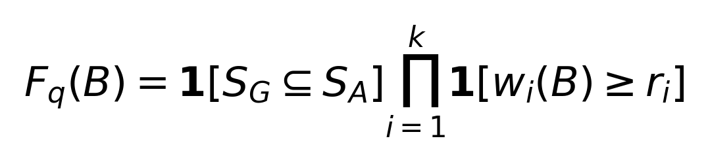
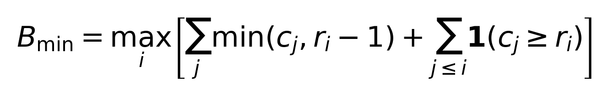

# پیوست الف نمادگذاری و شرط دقیق

## ناحیه و پنجره‌ی مجاز

ناحیه‌ی i در یک جلسه، بازه‌ی نیمه‌باز l_i تا u_i با لنگر a_i و ظرفیت c_i است. عرض آن در بودجه‌ی B با w_i نمایش داده می‌شود. پنجره پیوسته، داخل ناحیه و حامل لنگر است. کوچک‌ترین فاصله‌ی پوشاننده‌ی لنگر و موقعیت‌های مرجع داخل ناحیه، r_i است؛ اگر مرجع خالی باشد، r_i برابر یک است.

F_q(B) شاخص امکان کامل‌پوشانی پرسش q است. S_G و S_A به‌ترتیب مجموعه‌ی جلسه‌های مرجع و دارای لنگرند. k تعداد ناحیه‌ها و در قرارداد محوری هشت است. نماد 1 شاخص شرط است؛ حاصل‌ضرب، برقرار بودن شرط عرض برای همه‌ی ناحیه‌ها را الزام می‌کند.



ضرورت از پیوستگی و مجزا بودن ناحیه‌ها و کفایت از ساخت شروع مجاز پنجره نتیجه می‌شود. صورت‌بندی، اثبات و قرارداد برچسب در S18F ثبت شده‌اند؛ معادله از همان مرحله است.

## کمترین بودجه‌ی تخصیص نوبتی

T_i(r) جایگاه واژه‌ی rام ناحیه‌ی i در ترتیب تخصیص نوبتی است. پیش از دور r، هر ناحیه حداقل ظرفیت خود یا r منهای یک واژه دریافت کرده است. در همان دور، ناحیه‌های فعال تا i نیز به هزینه‌ی پیش از واژه‌ی مورد نیاز اضافه می‌شوند. بزرگ‌ترین جایگاه لازم، کمترین بودجه‌ی کل را تعیین می‌کند.



این مقدار به تخصیص و لنگرهای ثابت وابسته است و برای جلسه‌ی غایب متناهی نیست. این کمینه، شاهد معنایی پاسخ یا حد بهینه‌ی معماری دیگر نیست. کد و صورت رسمی معادلات در مخزن موجود است.

# پیوست ب نقشه‌ی بازتولید

## بررسی بدون متن خام

اجرای فرمان‌های زیر نتایج ثبت‌شده را از نظر ساختار، فرصت، گواه و اتصال ادعا بررسی می‌کند. این فرمان‌ها بازیابی تازه از تاریخچه‌ی خام انجام نمی‌دهند و فراخوانی مدل زبانی ندارند.

```text
python scripts/build_thesis_evidence.py --check
python scripts/build_thesis_synthesis.py --check
python scripts/validate_phase17.py --directory results
python scripts/validate_phase18.py --directory results
python scripts/validate_phase19.py --directory results
python scripts/validate_phase19.py --directory results --prefix phase19b
```

## بازاجرای منبع‌دار

دریافت منبع باید با نسخه و هش قرارداد انجام شود. راهنمای مرحله‌ی ۱۸ و ۱۹ مسیر دریافت، رتبه‌بندی، امتیازدهی و مقایسه‌ی خروجی را مشخص کرده است. اجرای منبع‌دار به دسترسی شبکه و داده نیاز دارد. خروجی تازه در پوشه‌ی جدا ذخیره شود تا سابقه‌ی منتشرشده جایگزین نشود. زمان اجرای محاسباتی، زمان دریافت داده، مرور منابع و تدوین را شامل نمی‌شود.

## دفتر ادعا و سابقه

دفتر ادعاهای یکپارچه، مقدار دقیق، مسیر پرونده، نشانی JSON و هش منبع هر ادعا را نگه می‌دارد. شناسه‌های داخلی این دفتر برای ممیزی محاسباتی حفظ شده‌اند؛ ارجاع‌های متن پایان‌نامه شماره‌های فهرست منابع هستند. نسخه‌ی اصلی دفتر و گزارش بسته‌ی اول حفظ می‌شوند. دفتر یکپارچه، مرحله‌ی ۱۷، ممیزی اندازه‌ی مرجع و تقسیم توسعه و ارزیابی اولیه را نیز به متن متصل می‌کند [Z03].

# پیوست پ واژه‌نامه

| اصطلاح | تعریف در این پژوهش |
|---|---|
| جلسه | واحد بومی تاریخچه در منبع و قرارداد همان داده |
| قطعه | واحدی که الگوریتم مرزبندی می‌سازد |
| لنگر | موقعیت واژه‌ی منتخب از نوبت رتبه‌گرفته |
| ناحیه | بازه‌ی اختصاصی لنگر در همان جلسه |
| فرصت انتخاب | تمام پنجره‌های قانونی با عرض و لنگر ثابت |
| پوشش کامل | حضور همه‌ی موقعیت‌های واژه‌ی مرجع تعریف‌شده |
| امکان دقیق | وجود دست‌کم یک انتخاب مجاز با پوشش کامل |
| مونتاژ شاهد | کنار هم قرار گرفتن شاهدهای مورد نیاز در خروجی |
| کفایت معنایی | امکان تعیین پاسخ از مجموعه‌ی شاهد و پرسش |
| صحت پاسخ | درست بودن پاسخ تولیدشده طبق داوری مشخص |
| تحلیل پس از نتیجه | تحلیلی که پس از دیدن نتیجه‌ی انگیزاننده تعریف شده |
| بازتولیدپذیری | امکان بازسازی نتیجه با نسخه و قرارداد ثبت‌شده |
